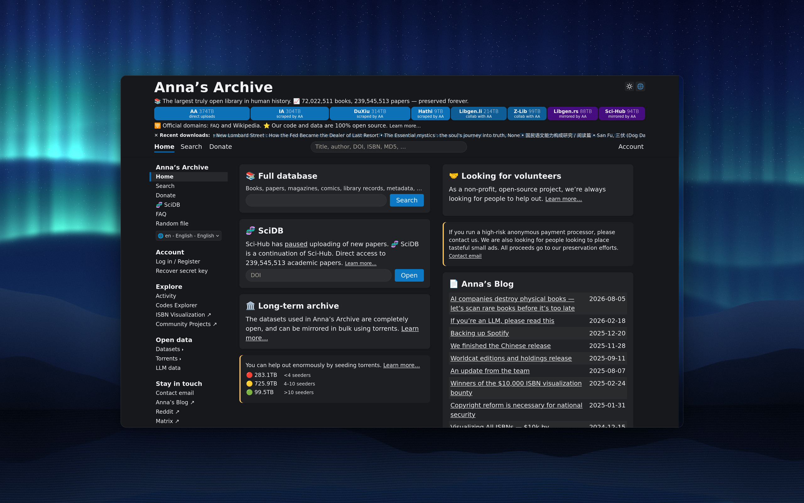
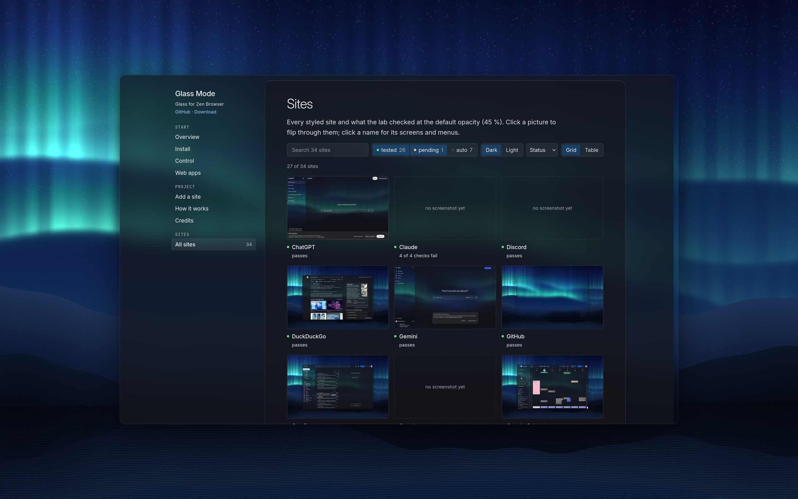
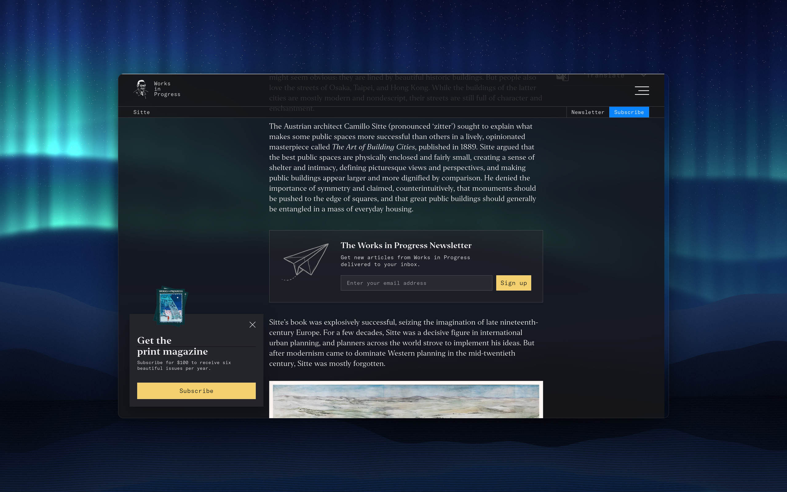
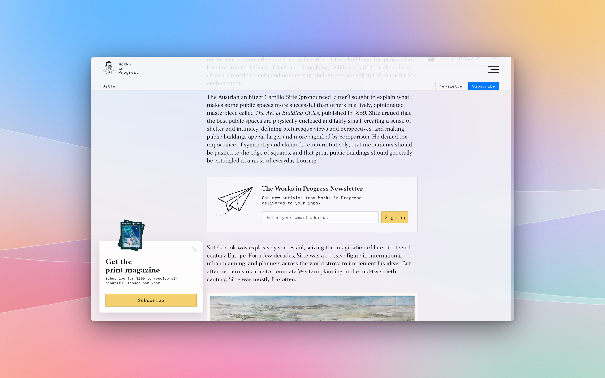
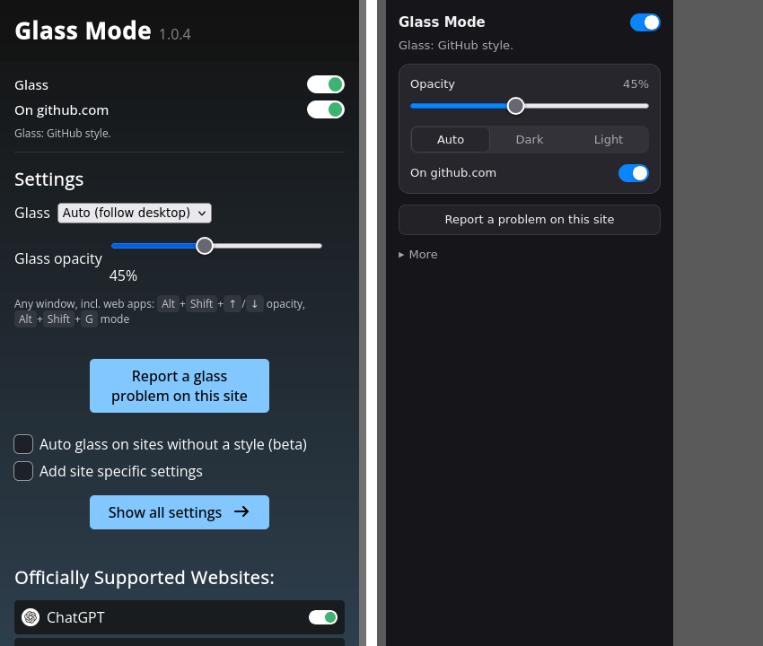

# Changelog

Installed copies update themselves within a day (about:addons → Check for Updates: now).

## 1.0.8

**Anna's Archive**, on every mirror domain (.li, .pk, .gl, .org…). The page reads on glass end to end: header,
sidebar and cards, with the blog list and inputs as frosted rows. The coloured library bar and blue buttons keep their
colours, and the payment notice is a card with an orange edge. Search result pages aren't styled from real pages yet:
the lab only gets Anna's bot wall, so this was built from the pages in your browser cache.

**Glass Mode's own website goes clear.** It used to draw a wallpaper picture behind fake glass. With the extension on,
your real desktop shows through instead: the sidebar sits on the frame and the article on the reading pane.

## 1.0.7

**Works in Progress.** The magazine's articles read on glass: the page sits on the reading tint, the header frosts as
the article scrolls under it, and the slide-out menu, cookie dialog and "Get the print magazine" card are frosted
panels. The newsletter and magazine boxes are cards, the yellow buttons stay yellow, and the line-art masthead and
icons turn white on dark glass. Photos keep their colours.

| Dark | Light |
|---|---|
|  |  |

## 1.0.6

**No more sharp text behind bars and menus.** A header, toolbar or side panel that the page scrolls under now turns to
frosted glass instead of staying clear, so whatever passes beneath it blurs out of the way of its own labels. Menus,
dropdowns and dialogs that open over the page get the same treatment, a little thicker. This works on every styled
site, not just the ones fixed by hand: it showed up on YouTube, Reddit, YouTube Music, Gmail, X, Substack and GitHub.

**Readwise Reader**
- The top bar of an open document no longer shows the article through it.
- The sidebar that slides over the article is frosted glass, not clear.
- The library list sits on the content tint, so its text has the same backing as the reader pane.

**New popup**, in Glass Mode's own glass colours and system font, light and dark. What you use every day is on top:
on/off, opacity, Auto/Dark/Light, this site on/off, and one button to report a problem or request the site. Everything
else is under "More".

## 1.0.5

- The opacity slider moves pages while you drag (was 500 ms behind), and its whole range does something: 10 % is
  properly clear, 90 % near solid. The default 45 % looks the same.
- Power Thesaurus, both its themes.
