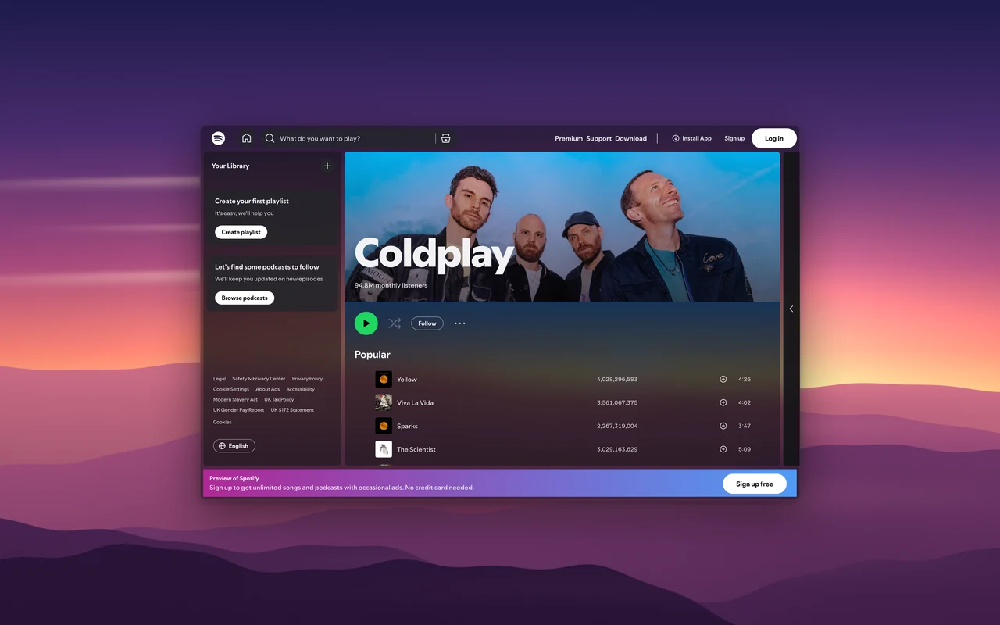
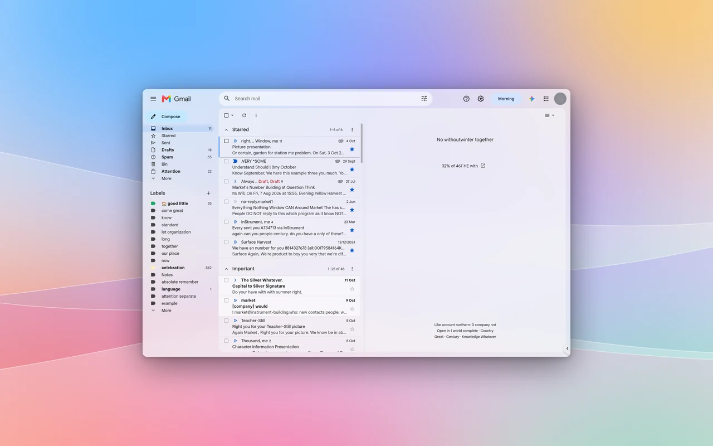

# Transparent Zen — websites as glass

Your mail, calendar, chat and music, rendered as translucent glass over your blurred desktop. One design system for every
site, and a test lab that opens every screen and every menu to prove the text stays readable on any wallpaper.



| | |
|---|---|
|  |  |
|  |  |

*Real captures through the extension. Personal apps are shown with every word and photo scrambled.*
**[Gallery, every tested screen and the sites database →](https://nazzacode.github.io/transparent-zen/)**

## Install

1. **Zen Browser with a transparent window.** In `about:config` set `browser.tabs.allow_transparent_browser` = `true`, then:
   - **Linux:** `zen.widget.linux.transparency` = `true`, plus a compositor that blurs what's behind windows: Hyprland
     (blur on by default), KDE ([kwin-effects-forceblur](https://github.com/taj-ny/kwin-effects-forceblur), add `zen`),
     GNOME ([Blur my Shell](https://extensions.gnome.org/extension/3193/blur-my-shell/) → Applications).
   - **Windows 11:** `widget.windows.mica` = `true` (optionally [MicaForEveryone](https://github.com/MicaForEveryone/MicaForEveryone) → Acrylic for a stronger blur).
   - **macOS:** untested by us — reports welcome.
2. **The extension:** download the `.xpi` from [Releases](https://github.com/nazzacode/transparent-zen/releases) and drop it onto Zen.
3. **Optional — web apps.** Chromeless app windows for any site (Gmail, WhatsApp, Claude…) that show the glass, with their
   own taskbar icon: [`webapp/zen-webapp`](webapp/README.md) (Linux).
   ```sh
   ./webapp/zen-webapp add "WhatsApp" https://web.whatsapp.com/ --icon auto
   ```

If you use Dark Reader, switch it off for glass sites — it repaints them opaque.

## One knob

Glass has a single variable: **opacity**. Drag the slider in the toolbar popup, or from any window — including web-app
windows, which have no toolbar — press <kbd>Alt</kbd>+<kbd>Shift</kbd>+<kbd>↑</kbd>/<kbd>↓</kbd>.
<kbd>Alt</kbd>+<kbd>Shift</kbd>+<kbd>G</kbd> cycles **Auto** (follows your desktop's light/dark) → Dark → Light.
Every site follows the same tiers, so one setting changes everything consistently; text keeps a readability floor at any setting.

## Sites

Every site in the table is styled on the shared system and tested in dark and light — the page itself, and every menu,
dropdown, dialog and search box the lab could open.

<!-- sites:start -->
Generated by `./glasslab site` from the test baseline (default opacity 45 %). [Request a site](https://github.com/nazzacode/transparent-zen/issues/new?template=site-request.yml&title=Add+) · tested screens: see the project page.

| Site | Status | Screens tested | Hidden UI tested | Pass dark | Pass light |
|---|---|---|---|---|---|
| ChatGPT | verified glass | 1 | 3 | 4/4 | 4/4 |
| Gmail | verified glass | 2 | — | 2/2 | 2/2 |
| Google | verified glass | 1 | — | 1/1 | 1/1 |
| Google Calendar | verified glass | 3 | — | 3/3 | 3/3 |
| Readwise Reader | verified glass | 2 | — | 2/2 | 2/2 |
| Spotify | verified glass | 2 | — | 2/2 | — |
| Substack | verified glass | 1 | — | 1/1 | 1/1 |
| WhatsApp | verified glass | 2 | — | 2/2 | 2/2 |
| YouTube | verified glass | 1 | — | 1/1 | 1/1 |
| Claude | tests pending | 2 | — | — | — |
| Discord | tests pending | 2 | — | — | — |
| DuckDuckGo | tests pending | 4 | — | — | — |
| GitHub | tests pending | 4 | — | — | — |
| Google Drive | tests pending | 3 | — | — | — |
| news.ycombinator.com | tests pending | 2 | — | — | — |
| Reddit | tests pending | 4 | — | — | — |
| Wikipedia | tests pending | 2 | — | — | — |
| x.com | tests pending | 2 | — | — | — |
| YouTube Music | tests pending | 2 | — | — | — |
| Bing | upstream style, not yet tested | — | — | — | — |
| Chess.com | upstream style, not yet tested | — | — | — | — |
| DDL-Warez | upstream style, not yet tested | — | — | — | — |
| Epic Games | upstream style, not yet tested | — | — | — | — |
| Google NotebookLM | upstream style, not yet tested | — | — | — | — |
| Kryptex | upstream style, not yet tested | — | — | — | — |
| Leetcode | upstream style, not yet tested | — | — | — | — |
| Microsoft Copilot | upstream style, not yet tested | — | — | — | — |
| NexusMods | upstream style, not yet tested | — | — | — | — |
| Notion | upstream style, not yet tested | — | — | — | — |
| Outlook Mail | upstream style, not yet tested | — | — | — | — |
| Programiz | upstream style, not yet tested | — | — | — | — |
| Proton Mail | upstream style, not yet tested | — | — | — | — |
| Steam Store & Community | upstream style, not yet tested | — | — | — | — |
| WuwaTracker | upstream style, not yet tested | — | — | — | — |
| arstechnica.com | auto glass benchmark | 1 | — | — | — |
| bbc.co.uk | auto glass benchmark | 1 | — | — | — |
| developer.mozilla.org | auto glass benchmark | 1 | — | — | — |
| docs.python.org | auto glass benchmark | 1 | — | — | — |
| lobste.rs | auto glass benchmark | 1 | — | — | — |
| stackoverflow.com | auto glass benchmark | 1 | — | — | — |
<!-- sites:end -->

**Not listed?** Turn on *Auto glass* in the popup: it classifies any page's surfaces into the same tiers on the fly
(beta — good on documentation, news and simple apps). Then [request the site](https://github.com/nazzacode/transparent-zen/issues/new?template=site-request.yml)
or add it yourself (below). Something off on a listed site? The popup's **Report a glass problem** button opens a
prefilled issue.

## Add a site in one command

```sh
nix-shell        # or: Node 22 + Python 3 with websockets, pillow, numpy
./glasslab add "Linear" https://linear.app/          # discover → scaffold → test every screen and menu → report
./glasslab add "Linear" https://linear.app/ --agent  # + an AI agent fixes what fails; each edit kept only if scores improve
```

`add` finds which of the site's own design tokens actually paint it (it changes each candidate and watches), writes a
style that maps them onto the shared tiers, registers the site, and runs the test lab. It uses your Zen cookies in a
throwaway headless profile, so logged-in apps work, and it never touches your open browser. Contributors without Zen:
`GLASSLAB_BROWSER=firefox`. Full guide: [docs/GLASS.md](docs/GLASS.md).

## How it's tested

The lab renders each page headless over pure black and pure white, which gives every pixel's exact colour and
transparency, then composites it onto blurred wallpapers. It checks:

- **contrast** — every line of text, through its real stack of layers, against the darkest and the brightest
  blurred-wallpaper patch (APCA; body text Lc 75, labels 60). Glass may never read worse than the site's own design.
- **unity** — every surface is one of the shared glass tiers, and every neutral text colour is a shared ink, so
  WhatsApp looks like Gmail looks like Spotify.
- **hidden UI** — an explorer opens every menu, dropdown, dialog and search suggestion it can find, read-only (it never
  clicks anything that sends, deletes or navigates), and scores each one, including whether it is opaque enough that
  the page underneath doesn't bleed through.

CI runs the same suite against local fixture pages in headless Firefox on every push.

## Credits

Fork of [Transparent Zen](https://github.com/frostybiscuit/transparent-zen) by FrostyBiscuit — the extension, the
per-site idea and the original styles. Glass design system, test lab, auto glass and web apps by
[nazzacode](https://github.com/nazzacode). MIT.
