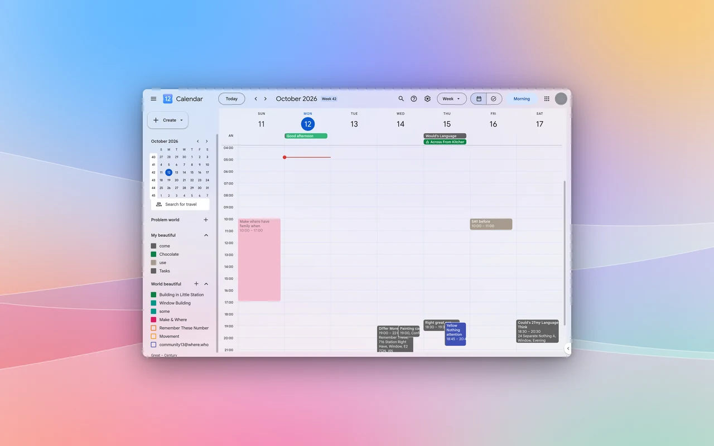
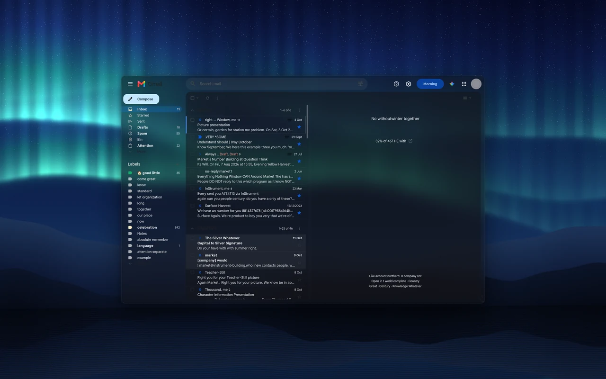

# Transparent Zen

Websites rendered as translucent glass in Zen Browser, readable on any wallpaper.



| | |
|---|---|
|  |  |
|  |  |

Screenshots of every tested site, screen and menu: [https://nazzacode.github.io/transparent-zen/](https://nazzacode.github.io/transparent-zen/)

- Styles for 24 sites, all on one set of glass tiers, so every site reads the same way.
- Auto glass for sites without a style (beta).
- One opacity setting: the popup slider, or Alt+Shift+Up/Down in any window. Alt+Shift+G switches auto, dark and light.
- Web-app windows for any site, with their own launcher entry (Linux).
- Every screen, menu and dialog is tested for contrast against the brightest and darkest wallpaper.

## Install

1. In Zen, open `about:config` and set `browser.tabs.allow_transparent_browser` to `true`.
2. Linux: also set `zen.widget.linux.transparency` to `true`. The blur comes from your compositor: Hyprland blurs out of the box, KDE needs [kwin-effects-forceblur](https://github.com/taj-ny/kwin-effects-forceblur), GNOME needs [Blur my Shell](https://extensions.gnome.org/extension/3193/blur-my-shell/).
3. Windows 11: also set `widget.windows.mica` to `true`. macOS is untested.
4. Download the `.xpi` from [Releases](https://github.com/nazzacode/transparent-zen/releases/latest) and open it in Zen.
5. Turn off Dark Reader for glass sites. It repaints them opaque.

## Control

Glass has one setting, opacity. Use the slider in the toolbar popup, or press Alt+Shift+Up and Alt+Shift+Down in any window, including web-app windows, which have no toolbar.

Alt+Shift+G cycles the mode: auto follows your desktop's light or dark theme, then dark, then light.

Text keeps a minimum contrast at every opacity, so low settings show more desktop without becoming unreadable.

## Web apps

`webapp/zen-webapp` turns a site into its own Zen window with a launcher entry and taskbar icon. It uses Firefox's Taskbar Tabs and shares your normal profile. Linux only.

```sh
./webapp/zen-webapp add "WhatsApp" https://web.whatsapp.com/ --icon auto
```

## Sites

<!-- sites:start -->
Generated by `./glasslab site` from the test baseline (default opacity 45 %). [Request a site](https://github.com/nazzacode/transparent-zen/issues/new?template=site-request.yml&title=Add+) · tested screens: see the project page.

| Site | Status | Screens tested | Hidden UI tested | Pass dark | Pass light |
|---|---|---|---|---|---|
| ChatGPT | verified glass | 1 | 3 | 4/4 | 4/4 |
| Claude | verified glass | 2 | — | 0/2 | 0/2 |
| Discord | verified glass | 1 | — | 1/1 | 1/1 |
| DuckDuckGo | verified glass | 4 | 18 | 22/22 | 22/22 |
| Gemini | verified glass | 1 | 3 | 4/4 | 4/4 |
| GitHub | verified glass | 4 | 38 | 42/42 | 42/42 |
| Gmail | verified glass | 2 | 13 | 15/15 | 15/15 |
| Google | verified glass | 1 | 5 | 6/6 | 6/6 |
| Google Calendar | verified glass | 3 | 18 | 21/21 | 21/21 |
| Google Drive | verified glass | 3 | 31 | 34/34 | 34/34 |
| Google Translate | verified glass | 2 | 11 | 13/13 | 13/13 |
| Hacker News | verified glass | 2 | — | 2/2 | 2/2 |
| Linear | verified glass | 3 | 7 | 10/10 | — |
| Notion | verified glass | 3 | 3 | 3/6 | 5/6 |
| Perplexity | verified glass | 1 | 1 | 1/2 | 2/2 |
| Readwise Reader | verified glass | 2 | 5 | 7/7 | 7/7 |
| Reddit | verified glass | 3 | 5 | 7/8 | 7/8 |
| Spotify | verified glass | 2 | 3 | 5/5 | — |
| Substack | verified glass | 1 | 6 | 7/7 | 7/7 |
| WhatsApp | verified glass | 2 | — | 2/2 | 2/2 |
| Wikipedia | verified glass | 3 | — | 3/3 | 3/3 |
| X | verified glass | 2 | 8 | 10/10 | 10/10 |
| YouTube | verified glass | 1 | 1 | 2/2 | 2/2 |
| YouTube Music | verified glass | 2 | 2 | 4/4 | — |
| Google apps launcher | upstream style, not yet tested | — | — | — | — |
| arstechnica.com | auto glass benchmark | 1 | — | 1/1 | 1/1 |
| bbc.co.uk | auto glass benchmark | 1 | — | 1/1 | 1/1 |
| developer.mozilla.org | auto glass benchmark | 1 | 8 | 1/9 | 1/9 |
| docs.python.org | auto glass benchmark | 1 | — | 1/1 | 1/1 |
| lobste.rs | auto glass benchmark | 1 | — | 1/1 | 1/1 |
| onthemarket.com | auto glass benchmark | 2 | — | — | — |
| stackoverflow.com | auto glass benchmark | 1 | 1 | 2/2 | 2/2 |
<!-- sites:end -->

## Add a site

One command discovers which of the site's own colour variables paint it, writes a style that maps them onto the glass tiers, registers the site and runs the tests.

```sh
./glasslab add "Linear" https://linear.app/
./glasslab add "Linear" https://linear.app/ --agent
```

With `--agent`, a coding agent fixes what fails. Each edit is kept only if the test scores go up, and it can only change that site's style file.

Or [request a site](https://github.com/nazzacode/transparent-zen/issues/new?template=site-request.yml&title=Add+). A maintainer labels the request and CI opens a pull request.

Full guide: [docs/GLASS.md](docs/GLASS.md).

## How it's tested

- Each page is captured over pure black and pure white, which gives the exact colour and transparency of every pixel.
- Contrast: every line of text, through its real stack of layers, against the darkest and the brightest blurred wallpaper (APCA; body text Lc 75, labels 60). Glass never reads worse than the site's own design.
- Unity: every surface is one of the shared tiers and every grey text colour is a shared ink.
- Hidden UI: the lab opens every menu, dropdown, dialog and search suggestion it can find and tests each one. It never clicks anything that sends, deletes, buys or signs out.
- CI runs the same suite on local test pages in headless Firefox on every push.

## Auto glass

For sites without a style, auto glass sorts the page's painted boxes into the same tiers (page, panel, menu, control) and maps grey text onto the shared inks by contrast. Brand colours, images and code keep their colours.

Switch it on in the popup. It is in beta: good on documentation, news and simple apps.

## Credits

Fork of [Transparent Zen](https://github.com/frostybiscuit/transparent-zen) by FrostyBiscuit, which made the extension and the per-site idea. Glass system, test lab, auto glass and web apps by nazzacode. MIT licence.
