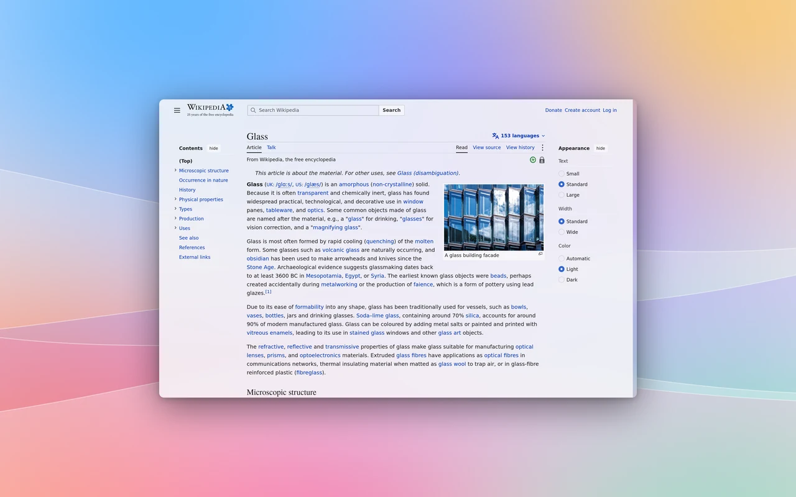
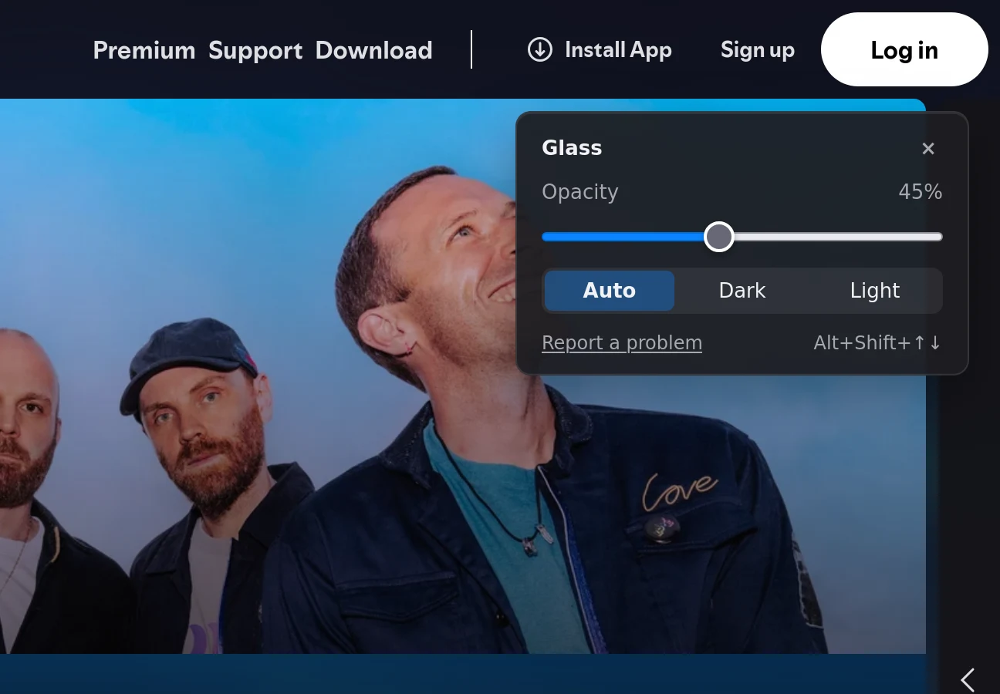
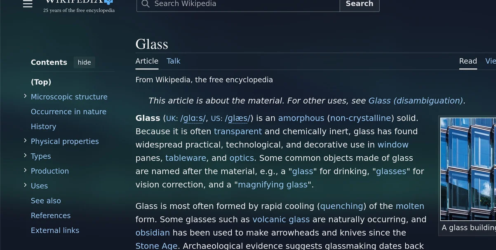
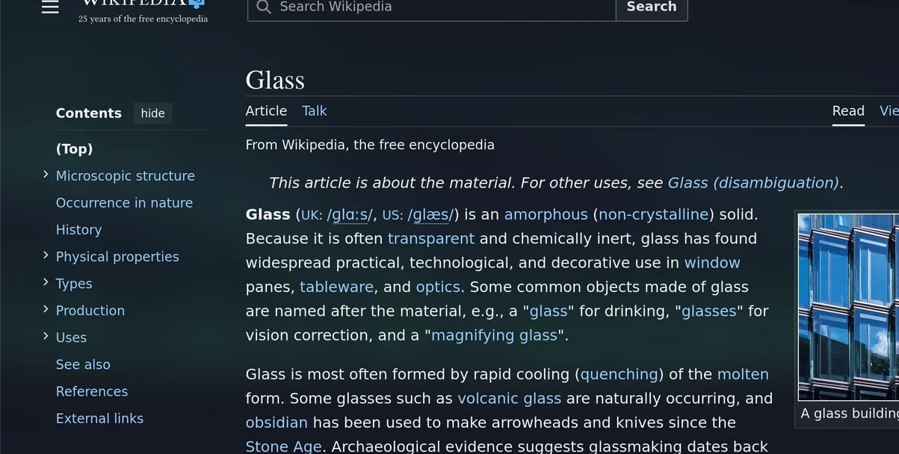
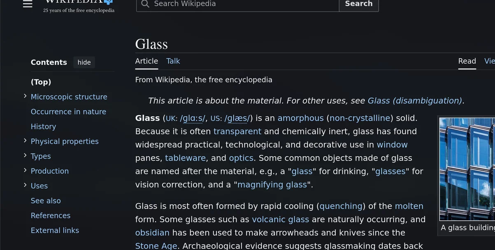
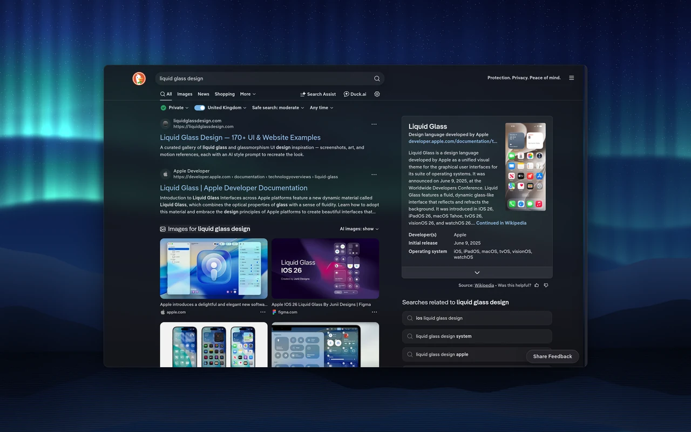
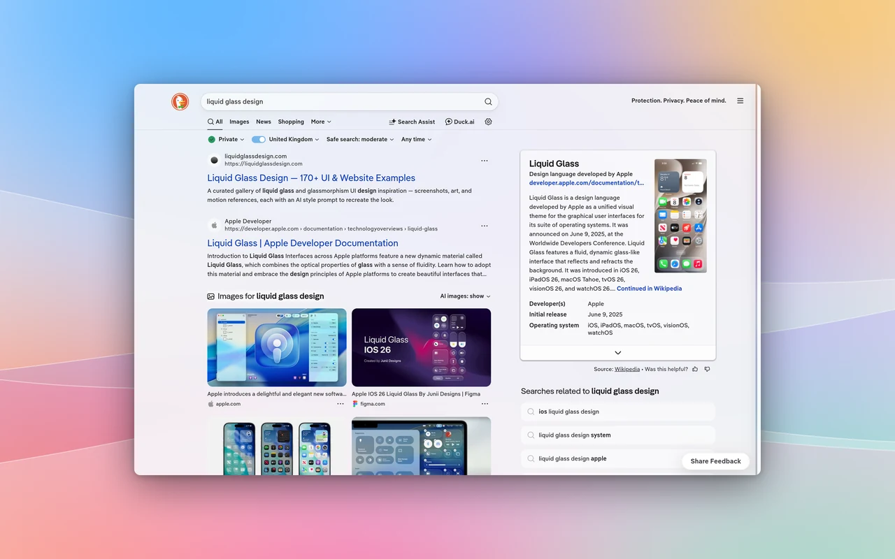
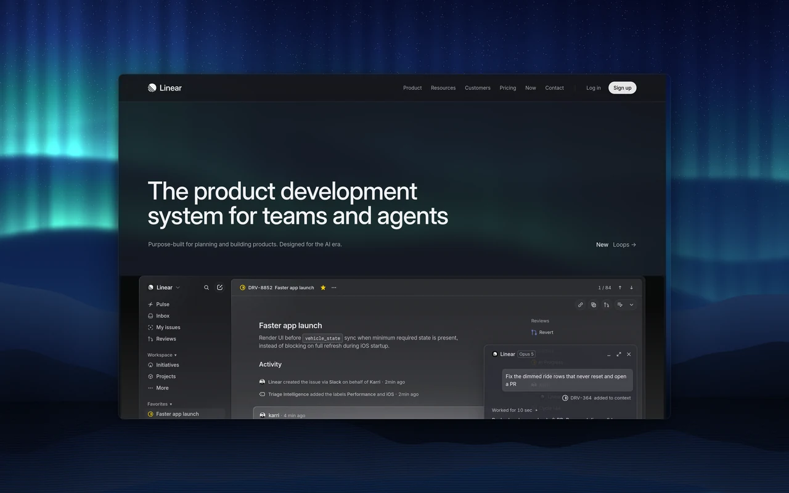

# Transparent Web

A browser extension that turns websites into frosted glass over your desktop. Text stays readable. Works in Zen Browser.

A fork of FrostyBiscuit's [Transparent Zen](https://github.com/frostybiscuit/transparent-zen), rebuilt around one design system and a test lab.

Website, every site and test results: [https://nazzacode.github.io/transparent-zen/](https://nazzacode.github.io/transparent-zen/)



- Hand-tuned styles for 24 sites: Gmail, Google Calendar, Spotify, WhatsApp, GitHub and DuckDuckGo.
- Other sites: automatic glass (beta).
- One slider: opacity. Alt+Shift+Up and Down change it from any page.
- Light and dark glass. Auto follows your system theme.
- Linux: run any site as its own app window.

Requirements: Zen Browser on Linux (Hyprland, KDE or GNOME) or Windows 11. macOS is untested.

## Why

Transparent desktops stop at the browser. Every website paints a solid box over your wallpaper, and making pages simply see-through leaves text unreadable over a busy background.

Transparent Web gives each site frosted panels and menus. Text contrast is measured on every screen and menu, against the brightest and darkest wallpaper.

It needs Zen because Zen has built-in window transparency, so your desktop can show through a web page. Chrome-based browsers can't do this. Firefox is untested.

## Install

1. Download [transparent-web.xpi](https://github.com/nazzacode/transparent-zen/releases/latest/download/transparent-web.xpi) and open it in Zen. It is signed by Mozilla.
2. In `about:config`, set `browser.tabs.allow_transparent_browser` to `true`, then the setting for your system:

- Linux: `zen.widget.linux.transparency` = `true`. Your compositor does the blur: Hyprland out of the box, KDE with [kwin-effects-forceblur](https://github.com/taj-ny/kwin-effects-forceblur), GNOME with [Blur my Shell](https://extensions.gnome.org/extension/3193/blur-my-shell/).
- Windows 11: `widget.windows.mica` = `true`.

Turn off Dark Reader for glass sites. It repaints them solid.

## Use



Press Alt+Shift+G in any page to open the glass panel. It also works in web-app windows, which have no toolbar.

Alt+Shift+Up and Alt+Shift+Down make glass more or less opaque.

| 10 % | 45 % (default) | 90 % |
|---|---|---|
|  |  |  |

Low opacity shows more desktop; high is nearly solid. Reading panes stay more opaque than sidebars, so text stays readable at every step.

| Dark | Light |
|---|---|
|  |  |

Auto follows your system theme. Dark glass suits dark wallpapers, light glass bright ones.

## Gallery

| | |
|---|---|
|  |  |

Every site, screen and menu: [https://nazzacode.github.io/transparent-zen/](https://nazzacode.github.io/transparent-zen/)

## FAQ

**Permissions.** It needs access to every site to style it. It collects nothing and sends nothing. The settings page only asks GitHub whether a newer version exists.

**Performance.** Site styles are plain CSS. The blur comes from your compositor, not the browser. Automatic glass reads the page once, then only what changes.

**Which sites?** 24 styled and tested, listed below. Every other site can use automatic glass.

**Something unreadable?** Open the panel and choose Report a problem. It opens a pre-filled issue.

## Sites

Each site is tested in light and dark, including its menus, dropdowns and dialogs.

<details><summary>All sites and test results</summary>

<!-- sites:start -->
Generated by `./glasslab site` from the test baseline (default opacity 45 %). [Request a site](https://github.com/nazzacode/transparent-zen/issues/new?template=site-request.yml&title=Add+) · tested screens: see the project page.

| Site | Status | Screens tested | Hidden UI tested | Pass dark | Pass light |
|---|---|---|---|---|---|
| ChatGPT | passes | 1 | 3 | 4/4 | 4/4 |
| Claude | 4 of 4 checks fail | 2 | — | 0/2 | 0/2 |
| Discord | passes | 1 | — | 1/1 | 1/1 |
| DuckDuckGo | passes | 4 | 18 | 22/22 | 22/22 |
| Gemini | passes | 1 | 3 | 4/4 | 4/4 |
| GitHub | passes | 4 | 38 | 42/42 | 42/42 |
| Gmail | passes | 2 | 13 | 15/15 | 15/15 |
| Google | passes | 1 | 5 | 6/6 | 6/6 |
| Google Calendar | passes | 3 | 18 | 21/21 | 21/21 |
| Google Drive | passes | 3 | 31 | 34/34 | 34/34 |
| Google Translate | passes | 2 | 11 | 13/13 | 13/13 |
| Hacker News | passes | 2 | — | 2/2 | 2/2 |
| Linear | passes | 9 | 29 | 38/38 | 28/28 |
| Notion | 4 of 12 checks fail | 3 | 3 | 3/6 | 5/6 |
| Perplexity | 1 of 4 checks fail | 1 | 1 | 1/2 | 2/2 |
| Readwise Reader | passes | 2 | 5 | 7/7 | 7/7 |
| Reddit | 2 of 16 checks fail | 3 | 5 | 7/8 | 7/8 |
| Spotify | passes | 3 | 3 | 5/5 | — |
| Substack | passes | 1 | 6 | 7/7 | 7/7 |
| WhatsApp | passes | 2 | — | 2/2 | 2/2 |
| Wikipedia | passes | 3 | — | 3/3 | 3/3 |
| X | passes | 2 | 8 | 10/10 | 10/10 |
| YouTube | passes | 1 | 1 | 2/2 | 2/2 |
| YouTube Music | passes | 2 | 2 | 4/4 | — |
| Google apps launcher | not tested yet | — | — | — | — |
| arstechnica.com | auto glass, passes | 1 | — | 1/1 | 1/1 |
| bbc.co.uk | auto glass, passes | 1 | — | 1/1 | 1/1 |
| developer.mozilla.org | auto glass, 16 of 18 checks fail | 1 | 8 | 1/9 | 1/9 |
| docs.python.org | auto glass, passes | 1 | — | 1/1 | 1/1 |
| lobste.rs | auto glass, passes | 1 | — | 1/1 | 1/1 |
| onthemarket.com | not tested yet | 2 | — | — | — |
| stackoverflow.com | auto glass, passes | 1 | 1 | 2/2 | 2/2 |
<!-- sites:end -->

</details>

## How it works

- Each style maps a site's own colours onto four shared layers: page, sidebar, content and menu.
- A test lab opens every screen and menu in a headless browser, measures text contrast against the brightest and darkest wallpaper, and checks every surface is glass. It never clicks anything that sends or deletes.
- Sites without a style get the same layers, guessed from the page's layout.

## Web apps (Linux)

`webapp/zen-webapp` opens a site in its own Zen window, with a launcher entry and taskbar icon. It uses your normal Zen profile, so you stay logged in.

```sh
./webapp/zen-webapp add "WhatsApp" https://web.whatsapp.com/ --icon auto
```

## Add a site

Missing a site? Turn on automatic glass in the toolbar popup, or [request the site](https://github.com/nazzacode/transparent-zen/issues/new?template=site-request.yml&title=Add+).

To add one yourself:

```sh
./glasslab add "Linear" https://linear.app/            # style, register, test
./glasslab add "Linear" https://linear.app/ --agent    # an agent fixes what fails
```

With `--agent`, edits are kept only if the test scores go up. Full guide: [docs/GLASS.md](docs/GLASS.md).

## Credits

Fork of [Transparent Zen](https://github.com/frostybiscuit/transparent-zen) by FrostyBiscuit. Glass system, test lab, automatic glass and web apps by nazzacode. MIT licence.
