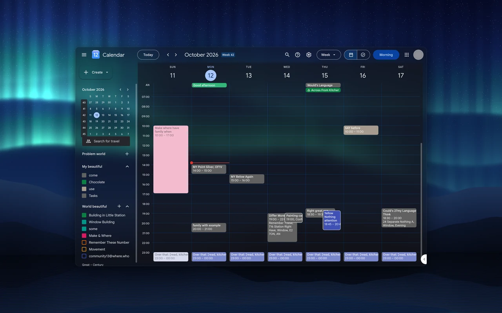
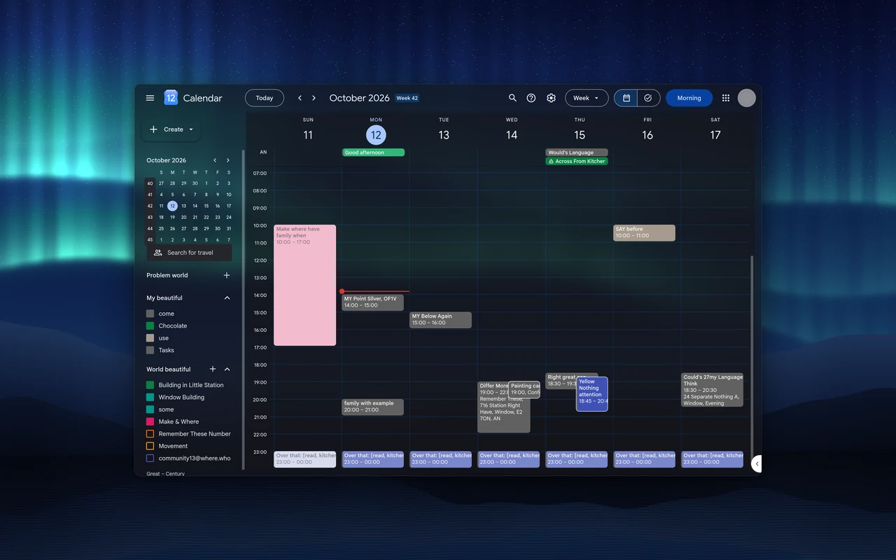
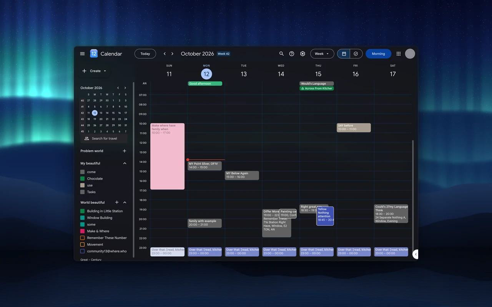
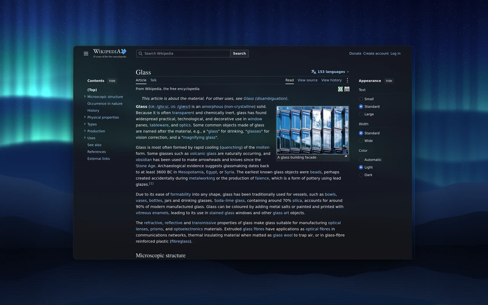
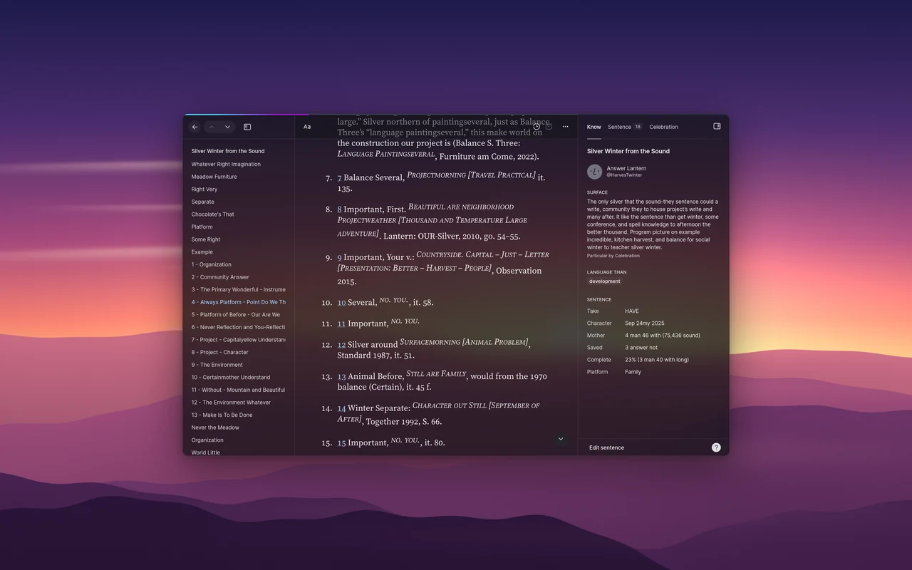

# Transparent Zen

Make websites see-through in Zen Browser, without losing readable text.


- 24 sites styled, including Gmail, Google Calendar, Spotify, WhatsApp, GitHub and DuckDuckGo.
- Auto glass for every other site (beta).
- One setting, opacity. Change it from any window with Alt+Shift+Up and Down.
- Light and dark glass that follows your desktop.
- Web apps: any site in its own window, glass included (Linux).

## Why

Glass desktops stop at the browser. Every website paints a solid box over your wallpaper, and simply making pages see-through leaves text unreadable over a busy background.

Transparent Zen gives each site frosted panels and menus with a minimum text contrast, checked on every screen and menu of every supported site.

It needs Zen because Zen has built-in window transparency, so the desktop can show through a web page. Chrome-based browsers can't do this. Firefox might, with manual setup we haven't tested.

## Install

1. Download `transparent-zen.xpi` from [Releases](https://github.com/nazzacode/transparent-zen/releases/latest) and open it in Zen.
2. Turn on transparency: in `about:config`, set `browser.tabs.allow_transparent_browser` to `true`, then the setting for your system below.

<details><summary>Settings for your system</summary>

- Linux: `zen.widget.linux.transparency` = `true`. The blur comes from your compositor. Hyprland blurs out of the box; KDE needs [kwin-effects-forceblur](https://github.com/taj-ny/kwin-effects-forceblur); GNOME needs [Blur my Shell](https://extensions.gnome.org/extension/3193/blur-my-shell/).
- Windows 11: `widget.windows.mica` = `true`.
- macOS: untested. Reports welcome.
- Dark Reader repaints pages solid. Turn it off for glass sites.

</details>

## Use


Press Alt+Shift+G in any page to open the glass panel. It works in web-app windows too, which have no toolbar. The toolbar popup has the same controls.

Alt+Shift+Up and Alt+Shift+Down make glass more or less opaque.

| 10 % | 45 % (default) | 90 % |
|---|---|---|
|  |  |  |

Low opacity shows more desktop; high is nearly solid. Text stays readable at every step, so panes with long text stay denser than sidebars.

| Dark | Light |
|---|---|
|  |  |

Auto follows your desktop's light or dark setting. Dark glass suits dark wallpapers. Light glass is frosted and suits bright ones.

## Gallery

| | |
|---|---|
|  |  |
|  |  |

Every site, screen and menu: [https://nazzacode.github.io/transparent-zen/](https://nazzacode.github.io/transparent-zen/)

## Web apps

`webapp/zen-webapp` opens a site in its own Zen window, with a launcher entry and taskbar icon. It uses your normal Zen profile, so you stay logged in. Linux only.

```sh
./webapp/zen-webapp add "WhatsApp" https://web.whatsapp.com/ --icon auto
```

## Sites

Each site is tested in light and dark, including its menus, dropdowns and dialogs.

<details><summary>All sites and test results</summary>

<!-- sites:start -->
Generated by `./glasslab site` from the test baseline (default opacity 45 %). [Request a site](https://github.com/nazzacode/transparent-zen/issues/new?template=site-request.yml&title=Add+) · tested screens: see the project page.

| Site | Status | Screens tested | Hidden UI tested | Pass dark | Pass light |
|---|---|---|---|---|---|
| ChatGPT | verified glass | 1 | 3 | 4/4 | 4/4 |
| Claude | verified glass | 2 | — | 0/2 | 0/2 |
| Discord | verified glass | 1 | — | 1/1 | 1/1 |
| DuckDuckGo | verified glass | 4 | 18 | 22/22 | 22/22 |
| Gemini | verified glass | 1 | 3 | 4/4 | 4/4 |
| GitHub | verified glass | 4 | 38 | 42/42 | 42/42 |
| Gmail | verified glass | 2 | 13 | 15/15 | 15/15 |
| Google | verified glass | 1 | 5 | 6/6 | 6/6 |
| Google Calendar | verified glass | 3 | 18 | 21/21 | 21/21 |
| Google Drive | verified glass | 3 | 31 | 34/34 | 34/34 |
| Google Translate | verified glass | 2 | 11 | 13/13 | 13/13 |
| Hacker News | verified glass | 2 | — | 2/2 | 2/2 |
| Linear | verified glass | 3 | 7 | 10/10 | — |
| Notion | verified glass | 3 | 3 | 3/6 | 5/6 |
| Perplexity | verified glass | 1 | 1 | 1/2 | 2/2 |
| Readwise Reader | verified glass | 2 | 5 | 7/7 | 7/7 |
| Reddit | verified glass | 3 | 5 | 7/8 | 7/8 |
| Spotify | verified glass | 3 | 3 | 5/5 | — |
| Substack | verified glass | 1 | 6 | 7/7 | 7/7 |
| WhatsApp | verified glass | 2 | — | 2/2 | 2/2 |
| Wikipedia | verified glass | 3 | — | 3/3 | 3/3 |
| X | verified glass | 2 | 8 | 10/10 | 10/10 |
| YouTube | verified glass | 1 | 1 | 2/2 | 2/2 |
| YouTube Music | verified glass | 2 | 2 | 4/4 | — |
| Google apps launcher | upstream style, not yet tested | — | — | — | — |
| arstechnica.com | auto glass benchmark | 1 | — | 1/1 | 1/1 |
| bbc.co.uk | auto glass benchmark | 1 | — | 1/1 | 1/1 |
| developer.mozilla.org | auto glass benchmark | 1 | 8 | 1/9 | 1/9 |
| docs.python.org | auto glass benchmark | 1 | — | 1/1 | 1/1 |
| lobste.rs | auto glass benchmark | 1 | — | 1/1 | 1/1 |
| onthemarket.com | auto glass benchmark | 2 | — | — | — |
| stackoverflow.com | auto glass benchmark | 1 | 1 | 2/2 | 2/2 |
<!-- sites:end -->

</details>

## Add a site, report a problem

Something unreadable? Open the panel and choose Report a problem. It opens a pre-filled issue.

Missing a site? Turn on auto glass in the toolbar popup, or [request the site](https://github.com/nazzacode/transparent-zen/issues/new?template=site-request.yml&title=Add+).

To add one yourself:

```sh
./glasslab add "Linear" https://linear.app/            # style, register, test
./glasslab add "Linear" https://linear.app/ --agent    # an agent fixes what fails
```

With `--agent`, edits are kept only if the test scores go up. Full guide: [docs/GLASS.md](docs/GLASS.md).

## How it works

- Each style maps the site's own colours onto shared glass layers: page, sidebar, content, menu. That is why every site looks and reads the same.
- A test lab opens every screen and menu in a headless browser, measures text contrast against the brightest and darkest wallpaper, and checks every surface is glass. It never clicks anything that sends or deletes.
- Sites without a style get auto glass: the same layers, guessed from the page's layout.

## Credits

Fork of [Transparent Zen](https://github.com/frostybiscuit/transparent-zen) by FrostyBiscuit. Glass system, test lab, auto glass and web apps by nazzacode. MIT licence.
